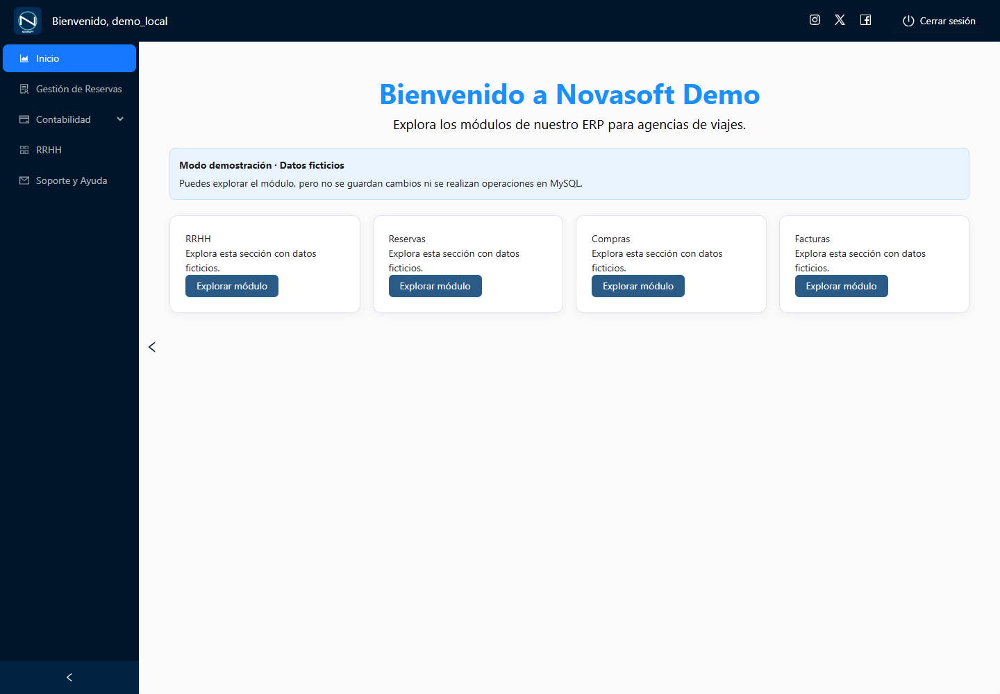
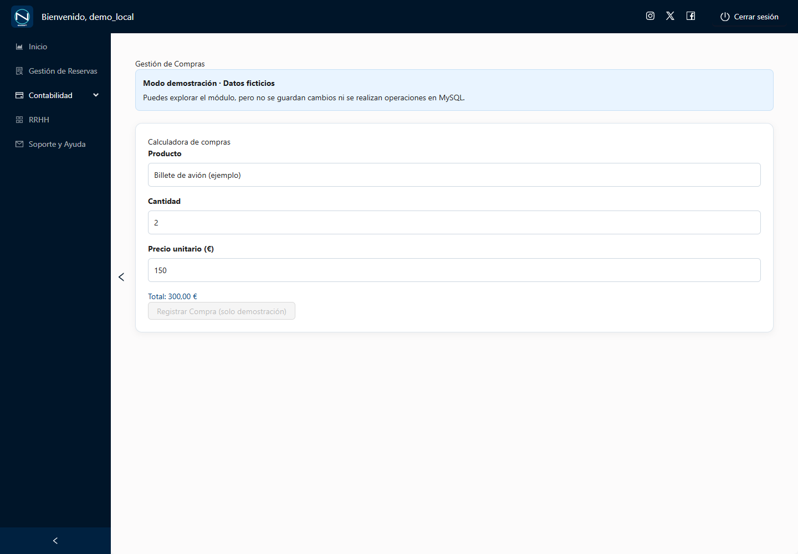
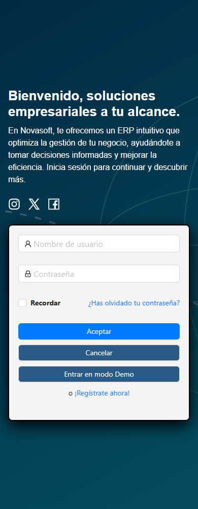

# Novasoft — ERP para agencias de viajes

Proyecto académico de portfolio Full Stack Junior. Reúne gestión de reservas, compras,
facturación y recursos humanos en una interfaz React con una API Node.js/Express y
persistencia MySQL. Esta edición incorpora una demo local navegable con datos ficticios.

## Qué puedes explorar

- Acceso mediante **Entrar en modo Demo**, sin cuenta, JWT, API ni base de datos.
- Inicio con navegación por módulos; pantallas de RRHH, reservas, compras y facturas.
- Simulador de reserva, calculadora de compras y descarga de un PDF de ejemplo.
- Diseño adaptable a escritorio y móvil. Las altas y bajas de la demo están bloqueadas.
- Código de API con JWT HS256, bcrypt, consultas parametrizadas, control de roles,
  límites de intentos y pruebas de registro/recuperación mediante dobles en memoria.

La demo no persiste cambios. El PDF no es una factura fiscal. No se ofrece un enlace a
una demo pública porque no se ha verificado ni publicado ningún despliegue de esta copia.

## Tecnologías y arquitectura

React 18, Vite 6, React Router, Ant Design, Tailwind CSS, Axios y jsPDF en el cliente;
Node.js, Express, mysql2, bcryptjs y jsonwebtoken en el servidor; MySQL para el diseño
persistente. Pruebas con node:test y recorridos opcionales con Playwright.

```text
src/                         Interfaz React, rutas y estado de sesión
src/componente/pgPrincipal/  Demo y datos ficticios
src/services/               Cliente HTTP común (deshabilitado sin configuración)
backend/routes/             Endpoints y permisos por rol
backend/controllers/        Operaciones del ERP
backend/security/           JWT, validación y revocación por cambio de credencial
backend/services/           Recuperación probada con transporte simulado
backend/models/             Conexión restringida a MySQL local
backend/tests/              Pruebas con dobles de BD/correo
tests/                      Pruebas del cliente y recorridos de navegador
docs/                       Auditoría de esta edición y capturas seguras
```

El modo Demo renderiza componentes con datos en memoria, sin montar los módulos que
acceden a la API. La marca de demo del navegador sólo controla la presentación. La API
valida la firma JWT y consulta el rol actual; la interfaz no es una barrera de autorización.

## Roles del código de la API

| Rol | Permisos implementados |
| --- | --- |
| Administrador (1) | RRHH, reservas, compras y facturas; alta/baja de contables y agentes |
| Contable (2) | Consulta de RRHH y reservas; compras y facturas |
| Agente (3) | Consulta de RRHH/reservas y registro de viajes |
| Cliente (4) | Sin acceso a endpoints internos; navegación básica |
| Demo (6) | Presentación ficticia local; sin permisos administrativos de API |

El registro público fija Cliente, rechaza selección de rol y requiere unicidad del nombre
en la BD. No se crea ninguna cuenta real en esta distribución.

## Instalación reproducible de la demo

Requisitos: Node.js 22 o superior y npm. Validación realizada con Node 22.14.0/npm 10.9.2.
No necesitas MySQL ni copiar un archivo de entorno para explorar la demo.

```sh
npm ci --ignore-scripts
npm run dev
```

Abre http://127.0.0.1:5173 y pulsa **Entrar en modo Demo**. La API está deshabilitada
por defecto. No introduzcas datos personales ni credenciales reales en esta edición.

```sh
npm test
npm run build
npm run preview
```

La vista previa suele estar en http://127.0.0.1:4173. El build genera dist/ localmente;
las dependencias y el build no forman parte de la entrega publicable.

## Configuración de ejemplo y backend

.env.example contiene únicamente nombres de variables y valores ficticios. Si necesitas
un entorno propio, cópialo como .env (ignorado). Ninguna variable VITE_ debe contener
secretos: Vite incorpora esos valores al JavaScript público.

El backend está desactivado salvo NOVASOFT_LOCAL_BACKEND=true; rechaza destinos de BD
que no sean loopback y exige configuración propia y una clave JWT larga distinta del
placeholder. Escucha exclusivamente en 127.0.0.1. VITE_API_URL se deja vacío en la demo.
No se incluyen certificados, cuentas, exportaciones de BD ni servicios de producción.

El esquema inicial completo de MySQL no está distribuido. La migración incluida sólo
modifica autenticación: **no crea toda la BD ni se ejecuta automáticamente**. Por ello,
el backend persistente necesita preparar y verificar un esquema local ficticio antes de
usar npm start; no se presenta como una instalación completa de producción.

El registro real depende del esquema y sus restricciones. El correo externo está
bloqueado en esta copia y las rutas reales de recuperación permanecen desactivadas.
Las pruebas sí ejercitan el flujo con BD y entrega de correo simuladas; esto no acredita
envíos ni operaciones contra servicios reales.

## Capturas

Capturadas exclusivamente con la build local, datos ficticios y red externa bloqueada.





## Pruebas y limitaciones

npm test cubre permisos, registro, recuperación, caducidad, consumo único, rollback,
revocación JWT, errores de red, estado Demo y bloqueo de configuraciones remotas.
No conecta a MySQL ni envía correo. Los scripts opcionales qa:auth y qa:demo requieren
Playwright 1.62.1 y Chrome instalado. Para ejecutarlos, instala Playwright en un entorno
local de pruebas separado y configura PLAYWRIGHT_MODULE con la ruta de su módulo;
qa:demo requiere ejecutar antes npm run build.

ESLint pasa sin errores ni advertencias. Persisten el aviso de tamaño de bundle y las limitaciones
del backend académico: transacciones de compras/reservas sobre conexión compartida y
posible carrera al crear facturas. No se recomienda exponer el backend a Internet sin
una revisión específica. Soporte es una maqueta sin envío y no hay editor de permisos.

## Publicación y autoría

Copia independiente, sin historial Git, remotos ni despliegues configurados. Su preparación
no autoriza publicar. Los SVG de esta edición se han creado para sustituir imágenes de
procedencia/licencia no acreditada en el origen. No se asigna automáticamente una licencia
al código; el titular deberá decidirla antes de distribuirlo con permisos de reutilización.
